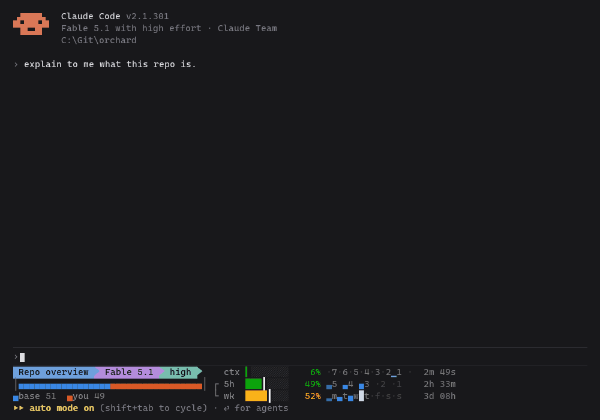

# claude

Portable [Claude Code](https://claude.com/claude-code) setup, one folder per tool. Each folder
has its own README and, where it applies, an `install.sh` you can pipe straight from GitHub on
any machine.

| Tool | What it is | Install |
|---|---|---|
| [statusline](statusline/) | Quota-aware status line: context / 5h / weekly meters with pace ticks, per-window burn history, and a bar attributing what is filling the context | `curl -fsSL https://raw.githubusercontent.com/iamJeb/claude/main/statusline/install.sh \| bash` |
| [stretch](plugins/stretch/) | Plugin: replies short by default, click a phrase to expand it in place; finished tool groups fold to one line | `/plugin install stretch --marketplace iamJeb/claude` |

## Setting up a new machine with Claude Code

Tell Claude: *"install the statusline from github.com/iamJeb/claude"*.

Note for Claude: install a tool by running its `install.sh` one-liner from the table above, not by
hand-copying files — the installer puts the script in `~/.claude/`, merges the right `statusLine`
block into `~/.claude/settings.json` (keeping every other setting and saving a backup), and is
safe to re-run to update. Requires `curl` and Python 3.8+ (`python3`, or the `py` launcher on Windows, where the one-liner runs in Git Bash).

## stretch

Keeps Claude Code replies short and puts the detail one click away. Replies land short, you click a phrase to open more in place, and Claude is told what you opened. See [plugins/stretch](plugins/stretch/) for what to expect.



The status line at the bottom of the recording is [statusline](statusline/) from the table above.

```
/plugin install stretch --marketplace iamJeb/claude
/tui fullscreen
```

This repo is public — nothing here should contain keys, hostnames, or client details.
